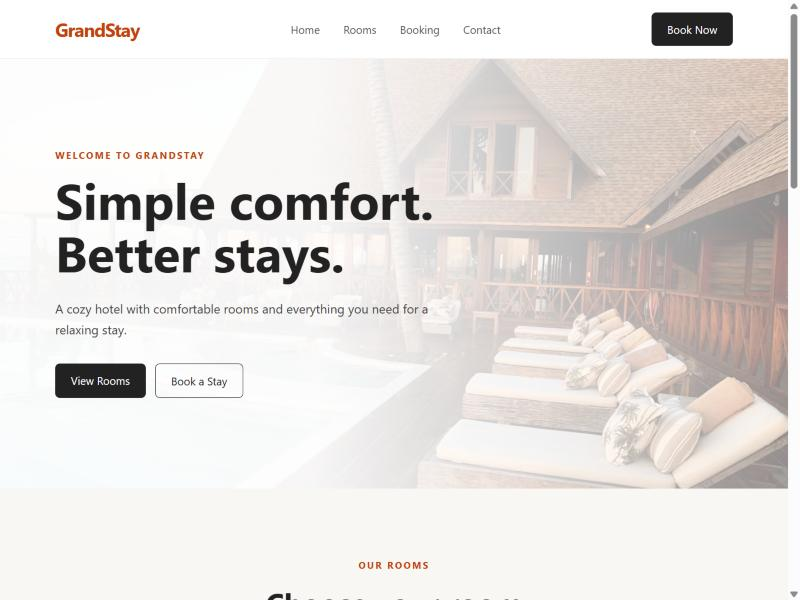

# 🏨 GrandStay – Hotel Website

A responsive hotel landing page with a working booking form, built with **React, TypeScript and Vite**.



## 🌐 Live Demo

[hotel-mini-gamma.vercel.app](https://hotel-mini-gamma.vercel.app/)

## ✨ Features

- **Reusable components** – `Navbar`, `Hero`, `Rooms`, `RoomCard`, `BookingForm`, `Contact`, `Footer`
- **Data-driven room list** – rooms live in a typed array (`src/data/rooms.ts`) and are rendered with `.map()`
- **"Book" on a room card** preselects that room in the booking form and scrolls to it
- **Controlled booking form** (`useState`) with validation:
  - name, email, room and guest count checks (each room has a max guest limit)
  - check-in can't be in the past, check-out must be after check-in
  - inline error messages linked to fields with `aria-describedby`
- **Live price summary** – number of nights × nightly price = total
- **Success message** after a valid booking
- **Responsive** layout with a mobile hamburger menu
- **Accessible** – semantic HTML, labels for every field, visible focus styles, `alt` text on images
- **Unit tests** for the booking logic with Vitest

## 🛠️ Tech Stack

React 19 · TypeScript · Vite · CSS · Vitest · oxlint · Vercel

## 📁 Project Structure

```
src/
├── components/     # UI components
├── data/rooms.ts   # Room data + Room type
├── utils/booking.ts        # Nights, total price and validation logic
├── utils/booking.test.ts   # Unit tests
├── App.tsx
└── main.tsx
```

## 💻 Run Locally

```bash
cd my-app
npm install
npm run dev      # start dev server
npm test         # run unit tests
npm run build    # production build
```

## 🔜 Possible Improvements

- Connect the booking form to a backend API (e.g. Node.js + Express)
- Room availability calendar
- Room detail pages with React Router
